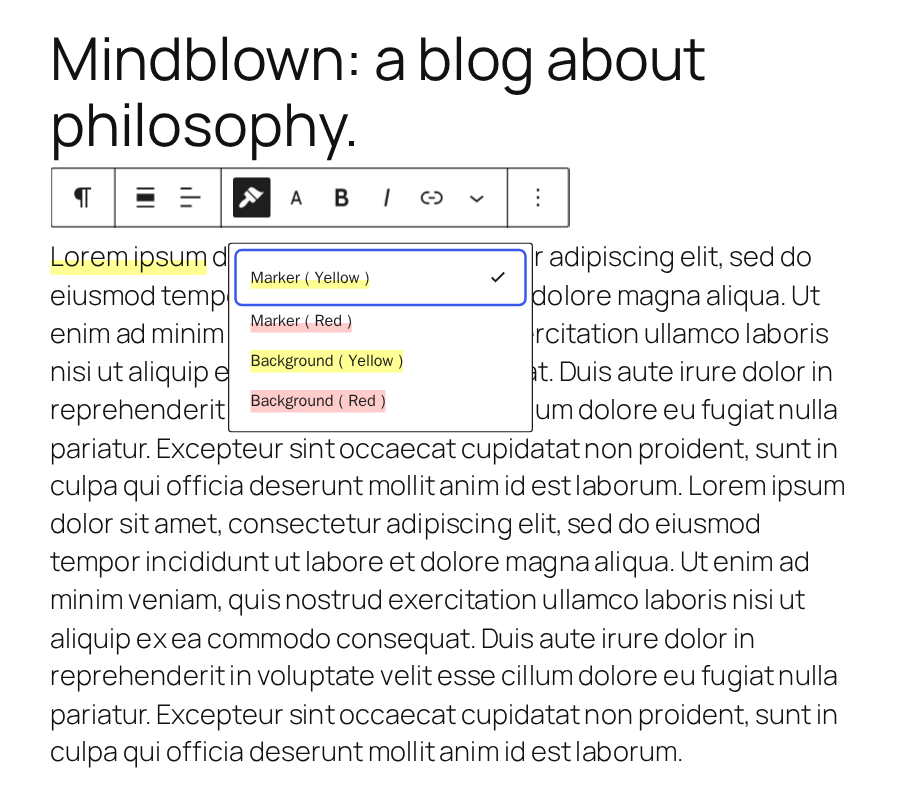
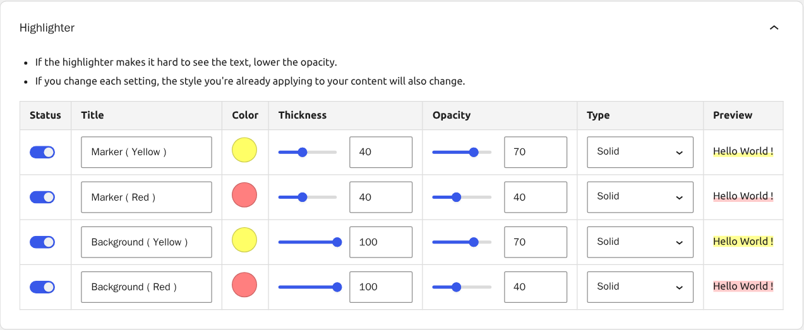
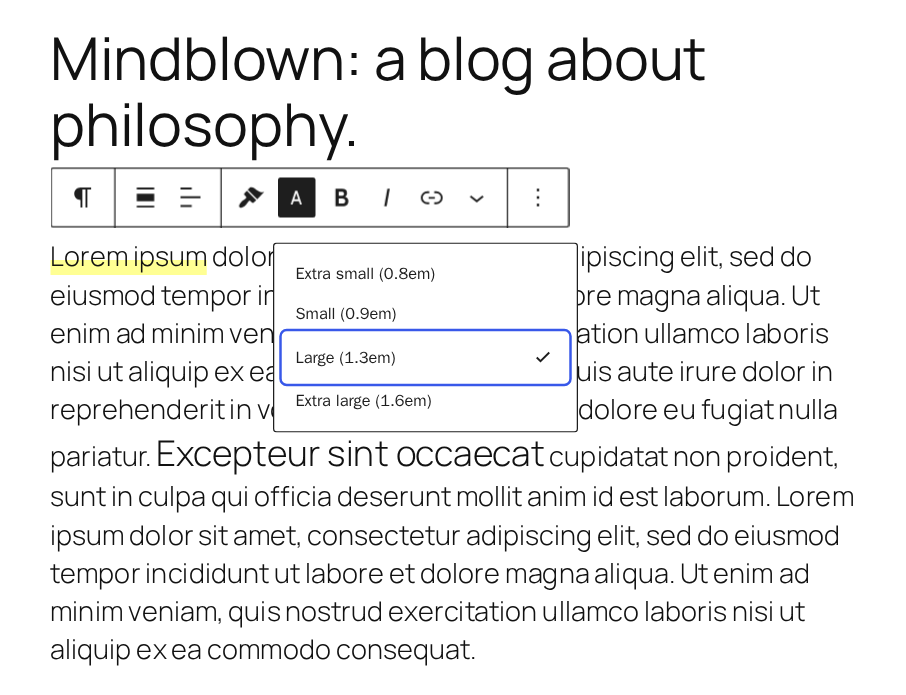
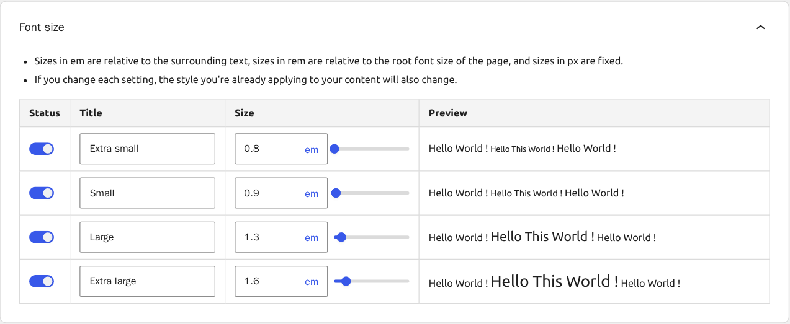

# richtext-extension

[](https://github.com/t-hamano/richtext-extension/actions/workflows/test.yml)
[](https://github.com/t-hamano/richtext-extension/actions/workflows/deploy.yml)

Adds useful decoration features to the Gutenberg RichText editor toolbar.

## Features

### Highlighter





Draw a marker on inline text. You can set the color, thickness, opacity, and type of the marker to create various marker styles. You can configure up to four highlighters.

### Font size





Change the size of inline text. You can specify the size in em, rem, or px, and configure up to four font sizes.

### Underline

Add an underline button to the block toolbar.

**Note: The underline markup has changed since version 2.0.0. If existing underlines do not work, try clearing the format.**

### Clear format

Remove all formatting from the selected text.

## How to build

Clone this repository into your `wp-content/plugins` directory, then build the plugin:

```sh
npm install
npm run build
```

## Author

[Aki Hamano (GitHub)](https://github.com/t-hamano)
